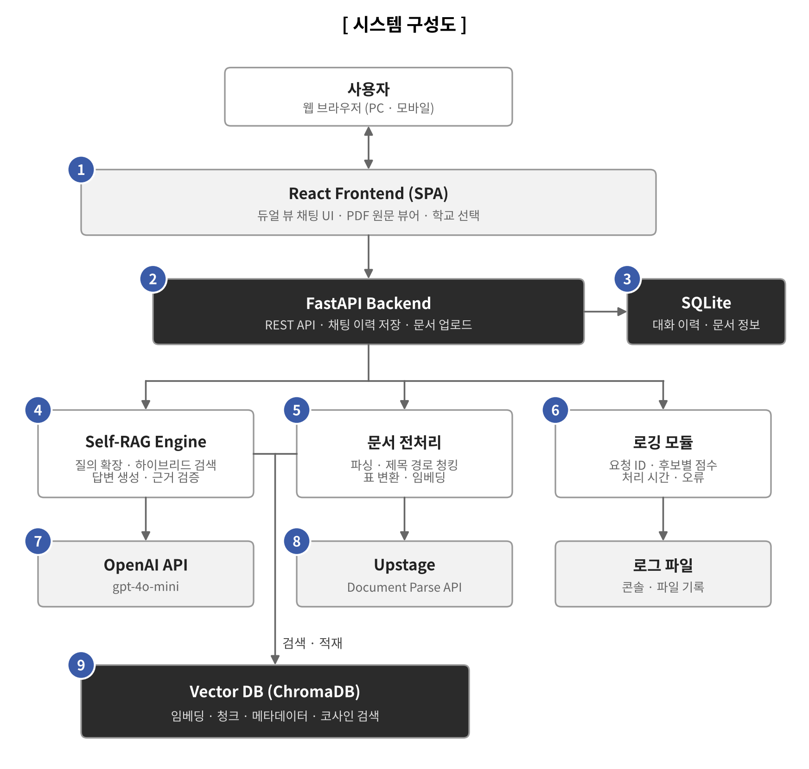
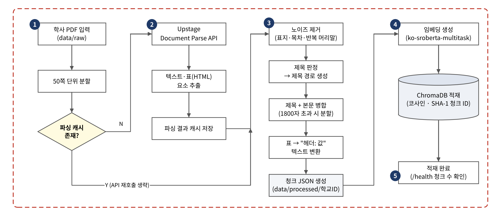

# Uni-Bot

2026 ICT 한이음 드림업 프로젝트에서 개발한 대학 학사 규정 안내 챗봇 서버 코드입니다.
RAG(Retrieval-Augmented Generation)와 Self-RAG 기법을 활용하여, 학칙·규정집 기반 질의응답과 근거 조항의 원문 하이라이팅을 제공하는 듀얼 뷰 웹 애플리케이션을 구현하였습니다.

## 프로젝트 소개

대학 학칙·규정집을 학습해서 학생 질문에 답변하는 RAG 기반 챗봇입니다.
답변 근거(조항)를 원문 PDF 페이지와 함께 보여주는 듀얼 뷰 UI를 제공합니다.

## 개발 배경

학칙과 학사 안내 문서는 분량이 많고 조항이 흩어져 있어, 학생이 필요한 규정을 직접 찾기 어렵습니다.
일반 LLM 챗봇은 학교별 규정을 모르거나 그럴듯한 오답을 만들 수 있어 학사 안내에 그대로 쓰기 어렵습니다.
Uni-Bot은 학교 문서에서 근거를 찾아 답하고, 그 근거를 원문 위에 직접 보여줍니다.

## 시연
- 시연 영상: [YouTube](https://www.youtube.com/watch?v=5LZM0tI3TYU)
- 체험하기: http://3.35.167.130/ (2026년 11월까지 운영)

[](https://www.youtube.com/watch?v=5LZM0tI3TYU)

## 시스템 구성도


| 구성 요소 | 역할 | 주요 파일 |
| --- | --- | --- |
| 프론트엔드 | 학생용 듀얼 뷰(채팅 + 원문 PDF), 관리자 대시보드(문서 관리·검증 로그·신뢰도 분석 등) | `frontend/src/App.jsx`, `components/ChatScreen.jsx`, `components/PdfViewer.jsx`, `pages/` |
| API 서버 | 채팅·검색·채팅 이력·문서 업로드/목록 API, 서버 시작 시 임베딩 모델 warm-up | `backend/app/main.py` |
| 문서 전처리 | Upstage 파싱 결과에서 제목 경로를 만들어 청크 앞에 붙이고, 표를 텍스트로 변환 | `app/services/pdf_service.py`, `app/utils/table_parser.py` |
| 검색 (RAG) | 임베딩·ChromaDB 적재, 동의어 확장 + 하이브리드 검색 | `app/services/rag_service.py`, `app/services/synonyms.py` |
| 답변 생성 / Self-RAG | 근거 기반 답변 생성, 답변–근거 일치 검증 및 차단 | `app/services/answer_service.py` |
| 데이터 저장 | 벡터 DB(ChromaDB), 채팅 이력·문서 정보(SQLAlchemy ORM) | `chroma_db/`, `app/db.py`, `app/models.py` |
| 평가 스크립트 | 체크리스트 Top-N 검색 평가, 청킹 비교, Self-RAG 거부율 평가 | `backend/scripts/`, `backend/evaluation/`, `backend/experiments/` |

## 문서 전처리 흐름



### 프로젝트 구조

```
unibot/
├── backend/
│   ├── app/
│   │   ├── main.py                 # FastAPI 엔트리포인트 (라우트, 출처 묶기, 채팅 이력)
│   │   ├── db.py, models.py        # DB 연결, ChatLog / Document 모델
│   │   ├── services/
│   │   │   ├── pdf_service.py      # Upstage 파싱 + 제목 경로 청킹
│   │   │   ├── rag_service.py      # 임베딩, ChromaDB 적재, 하이브리드 검색
│   │   │   ├── synonyms.py         # 동의어 사전 (질의 확장)
│   │   │   └── answer_service.py   # OpenAI 답변 생성, Self-RAG 검증
│   │   ├── utils/table_parser.py   # HTML 표 → 텍스트 변환
│   │   └── Core/                   # 설정, 로거
│   ├── scripts/                    # 추출·평가·실험 스크립트
│   ├── evaluation/                 # 질문 체크리스트, 평가 결과
│   ├── experiments/                # 실험 보고서
│   ├── data/                       # 원본 PDF(raw), 전처리 청크(processed)
│   └── requirements.txt
└── frontend/
    └── src/
        ├── App.jsx                 # 학생/관리자 화면 전환, 듀얼 뷰 레이아웃
        ├── components/             # ChatScreen, PdfViewer, 공통 Header
        ├── pages/                  # 홈, 관리자 대시보드 하위 페이지
        ├── api/                    # 백엔드 API 호출 (axios)
        └── styles/
```

## 성과 및 평가

### 검색 정확도

20개 표준 질의 × 표현 3종(완전문장/구어체/키워드형) = 60건
- 사용 질문: `backend/evaluation/questions_checklist.csv` (20개 표준 질의 × 표현 3종(완전문장/구어체/키워드형) = 60건)
- 판정 결과: `backend/evaluation/auto_checklist_chunkid_result.csv`
- 판정 기준: 정답 키워드를 모두 포함한 청크가 Top-3 안에 있으면 PASS, Top-4~10이면 PARTIAL, 없으면 FAIL


| 판정 |  비율 |
| --- | --- |
| **PASS** | **43 (71.7%)** |
| PARTIAL | 7 (11.7%) |
| FAIL | 10 (16.7%) |


## 개발 환경

| 항목 | 내용 |
| --- | --- |
| OS | Windows 11, macOS |
| 런타임 | Python 3.11, Node.js 24 |
| 데이터베이스 | ChromaDB 1.5 (로컬 영속 저장), SQLite (기본) / PostgreSQL (`DATABASE_URL`로 전환) |
| 외부 API | OpenAI API (답변 생성·Self-RAG 검증, 기본 `gpt-4o-mini`), Upstage Document Parse API (PDF 파싱) |
| 배포 | AWS EC2 |
| 실행 포트 | 백엔드 `localhost:8000`, 프론트엔드 `localhost:5173` |

## 개발 언어

| 영역 | 언어 |
| --- | --- |
| 백엔드 / AI | Python |
| 프론트엔드 | JavaScript (JSX), HTML, CSS |

## 백엔드 실행 방법

```bash
cd backend
source .venv/bin/activate   # Windows: .venv\Scripts\Activate.ps1
pip install -r requirements.txt
uvicorn app.main:app --reload
```

브라우저에서 http://localhost:8000/docs 접속

### 환경 변수

`backend/.env` 파일을 만들고 아래 값을 채워주세요.

```
OPENAI_API_KEY=       # /api/chat 답변 생성에 사용 (answer_service.py)
UPSTAGE_API_KEY=      # PDF 파싱(pdf_service.py)에서 사용
```

```
답변 생성에 사용할 OpenAI 모델명
예: gpt-4o, gpt-4o-mini
OPENAI_MODEL=gpt-4o-mini

Self-RAG 검증에 사용할 OpenAI 모델명
예: gpt-4o-mini (저비용 검증용)
OPENAI_VERIFICATION_MODEL=gpt-4o-mini

Self-RAG 임계값 (0.0 ~ 1.0)
검증 score가 이 값보다 낮으면 근거 부족으로 차단
SELF_RAG_THRESHOLD=0.7
```

### 데이터 적재 (PDF → ChromaDB)

```bash
cd backend

# 1. PDF를 파싱해서 청크 JSON 만들기
python -m app.services.pdf_service data/raw/guide.pdf --school-id konkuk

# 2. 청크 JSON을 ChromaDB에 넣기
python -c "from app.services.rag_service import ingest_json; ingest_json('data/processed/konkuk/extracted_exp.json', reset=True)"
```

- 결과 파일은 `data/processed/<학교ID>/extracted_exp.json`에 저장됩니다.
- Upstage 파싱 결과는 캐시되어, 다시 실행해도 API를 재호출하지 않습니다. 새로 파싱하려면 `--force`를 붙이세요.
- `reset=True`는 기존 데이터를 지우고 새로 넣습니다. 다른 학교 데이터를 **추가**할 때는 `reset=False`로 실행하세요.


## 프론트엔드 실행 방법

```bash
cd frontend
npm install
npm run dev
```

## 주요 API

| Method | Path          | 설명                                       |
| ------ | ------------- | ------------------------------------------ |
| GET    | `/health`     | 서버 상태 및 적재된 청크 수 확인           |
| POST   | `/api/search` | ChromaDB 검색 결과만 확인 (답변 생성 없이) |
| POST   | `/api/chat`   | 검색 + 답변 생성을 포함한 채팅 API         |

## 팀 구성

| 담당   | 역할           |
| ------ | -------------- |
| 한다영 | Frontend       |
| 조한익 | Backend        |
| 이지은 | AI / Self-RAG  |
| 신예진 | OCR / Infra    |
| 유정진 | RAG 파이프라인 |